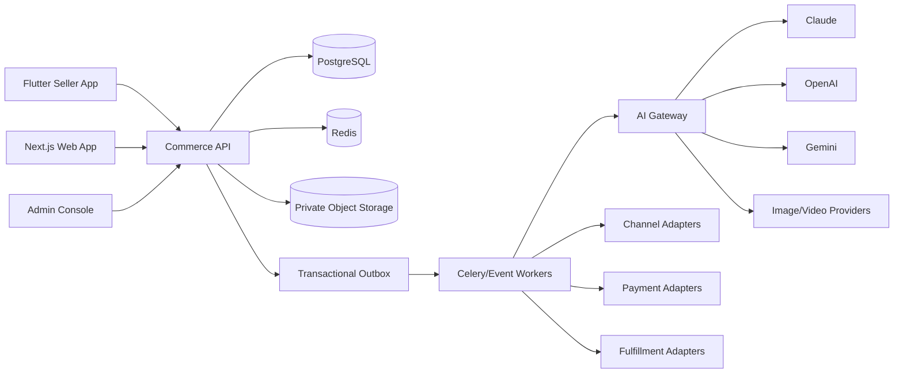

# System Architecture

## Style
Start with a **modular monolith + workers + durable events**.

## High-level

## Mandatory patterns
### Transactional outbox
Persist side-effect events in same DB transaction as domain change.

### Idempotency
Required for webhooks, external order imports, payments, refunds, shipments,
conversation→order and workflow actions.

### Adapters
Required for AI, channels, payments, couriers, notifications, storage, search.

### Capability discovery
Each channel reports capabilities:
product_listing, inventory_sync, content_publish, messages, orders, returns,
refunds, fulfillment. UI must respect these capabilities.

## Domain modules
accounts, merchants, channels, catalog, media, content, customers, inbox, orders,
inventory, procurement, payments, fulfillment, returns, automation, ai, analytics,
billing, audit, support.

## Multi-tenancy
Tenant ID on all merchant-owned records; service/query enforcement plus cross-tenant tests.

## Initial production
2+ API instances; 2+ workers; scheduler; managed PostgreSQL with PITR; managed Redis
where possible; private object storage; load balancer; separate dev/staging/prod;
central logs/metrics/traces; secret manager.

## Extract services only when
media/video load dominates; webhook volume needs independent scale; inbox streaming
requires it; analytics hurts OLTP; or team ownership/deployment boundaries justify it.
