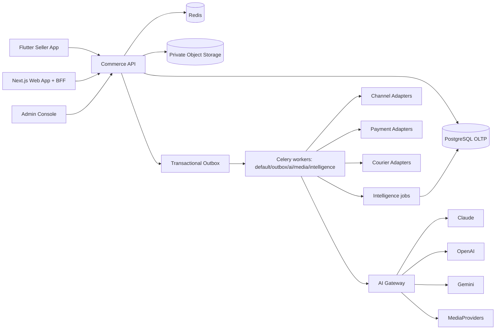

# System Architecture

> v2 (2026-11-02): adds the Intelligence Core, Digital Store Twin and Operational Learning Loop.

## Style
A **modular monolith + workers + durable events**. Domains are separate modules, deployed together
(ADR-001). Intelligence modules follow the same rule: separate code boundaries, the same deployable,
and their own worker queues.

## Target architecture
```text
                 AUTONOMOUS COMMERCE OS
                          │
        ┌─────────────────┴─────────────────┐
        │                                   │
   COMMERCE CORE                     INTELLIGENCE CORE
   (authoritative, transactional)    (derived, explainable)
        │                                   │
 Catalog / Product Brain inputs      Commerce Memory
 Customers                           Creative Genome
 Inventory                           COD Intelligence
 Orders                              Courier Intelligence
 Payments / COD                      Return Intelligence
 Fulfillment / Delivery              Supplier Intelligence
 Returns / Refunds                   Profit Intelligence
 Content / Channels                  Product Brain profiles
        │                                   │
        └─────────────────┬─────────────────┘
                          │
                  DIGITAL STORE TWIN  (derived read model)
                          │
                    AI STORE MANAGER  (tools + evidence)
                          │
            OBSERVE → DECIDE → RECOMMEND
                          │
       AUTOMATION ENGINE + AUTONOMOUS DECISION POLICY
                          │
                      AUTOPILOT
                          │
                  EXCEPTION INBOX
                          │
                        SELLER
```

## Runtime topology


## Mandatory patterns
- **Transactional outbox.** Side-effect events are persisted in the same DB transaction as the domain
  change (ADR-008).
- **Idempotency.** Required for webhooks, external order imports, payments, refunds, shipments,
  conversation→order, workflow actions, and the *execution of accepted recommendations*.
- **Adapters.** Required for AI, channels, payments, couriers, notifications, storage and search.
- **Capability discovery.** Each channel reports product_listing, inventory_sync, content_publish,
  messages, orders, returns, refunds and fulfillment. The UI respects these.
- **Unit of work commits before the response** (ADR-021).

## Commerce Core vs Intelligence Core
| | Commerce Core | Intelligence Core |
|---|---|---|
| Truth | Authoritative (orders, stock ledger, payments, shipments) | Derived from Commerce Core events and records |
| Writes | User/API/automation commands with invariants | Batch/stream computations; never mutate commerce facts |
| Storage | Normalised OLTP tables | Metric tables, fact tables, profiles, snapshots (04) |
| Failure mode | Must not lose or duplicate | May be stale; staleness is visible and bounded |
| Consumers | Everything | Store Manager, automation, recommendations, simulation, UI |

**Rule:** intelligence never becomes the source of a commercial fact. Price, stock, order, payment,
shipment and refund facts shown to customers or used in actions come from Commerce Core services at
execution time (00).

## Operational Learning Loop
| Step | Mechanism |
|---|---|
| OBSERVE | Domain events (outbox) + channel/courier/payment webhooks + content metrics ingestion |
| UNDERSTAND | Intelligence jobs compute metrics/facts into Commerce Memory and profiles (Product Brain, Courier, COD, Return, Supplier, Creative Genome) |
| DECIDE | Recommendation engine + Autonomous Decision Policy (risk × confidence × thresholds × entitlements) |
| ACT | Automation engine executes allowed actions via Commerce Core commands (idempotent, audited) |
| MEASURE | Outcome metrics linked to the action/recommendation (RecommendationOutcome, Autopilot metrics) |
| LEARN | Outcomes update metrics/priors (e.g. courier success by route, creative performance) |
| IMPROVE | Next decisions, generation prompts and policies use the updated state |

## Digital Store Twin: synchronisation model
The Twin is a **derived read model** of the live business. It is not a second transactional store.

- **Ownership.** Each Twin section is owned by the domain that produces it (orders section ← orders
  domain events). The Twin never accepts writes from clients.
- **Structure.** Typed sections per domain: catalog health, inventory position, order pipeline,
  payments/COD exposure, cash/settlement, content/campaigns, channels, warehouses, suppliers,
  shipments/couriers, returns/refunds, subscription/usage, automation state, active exceptions.
- **Refresh.**
  1. *Event-driven incremental*: outbox handlers update the affected section within seconds (target
     p95 < 60s).
  2. *Periodic reconciliation*: a scheduled full recompute per merchant (default every 6h, or on
     demand) corrects drift.
  3. *On-read freshness check*: a section older than its TTL is recomputed synchronously if cheap;
     otherwise it is returned with a `stale` flag.
- **Versioning.** Each section carries `as_of`, `source_version` (max event id applied) and
  `computed_at`. A `StoreTwinUpdated` event is emitted for material changes only (thresholded).
- **Consistency guarantee.** Eventual consistency, monotonic per section (an older event never
  overwrites newer state: compare `source_version`). Readers that need exact values (refund amount,
  available stock for an order) call Commerce Core, never the Twin.
- **Stale-state handling.** The UI shows `as_of`. Automation refuses to act on a section older than its
  action-specific max staleness (06), and the Store Manager states staleness in answers.
- **Snapshots.** Daily `StoreTwinSnapshot` rows (compact) support trends and simulation baselines.

## Domain modules
Commerce Core:
accounts, merchants, channels, catalog, media, content, studio, customers, inbox, orders, inventory,
procurement, payments, fulfillment, returns, marketing, automation, ai, analytics, billing, audit,
support, exceptions, platform.

Intelligence Core (from Phase 6):
productbrain, memory, twin, autopilot, recommendations, intelligence/{cod, courier, returns,
supplier, creative}, simulation (Phase 9), network (Phase 10).

## Multi-tenancy
A tenant ID is on all merchant-owned records, including every intelligence table. Enforcement is in
the ORM plus cross-tenant tests (ADR-002). Network Intelligence is the **only** cross-tenant reader. It
reads only through an aggregation service with k-anonymity thresholds (15) and writes only aggregates.

## Initial production
2+ API instances; 2+ workers per queue class (default, outbox, ai, media; intelligence from Phase 6);
one scheduler; managed PostgreSQL with PITR; managed Redis; private object storage; load balancer;
separate dev/staging/prod; central logs/metrics/traces; secret manager.

## Extract services only when
- media/video load dominates
- webhook volume needs independent scale
- inbox streaming requires it
- analytics/intelligence load hurts OLTP: first move intelligence reads to a read replica, then a
  columnar store
- team ownership or deployment boundaries justify it
